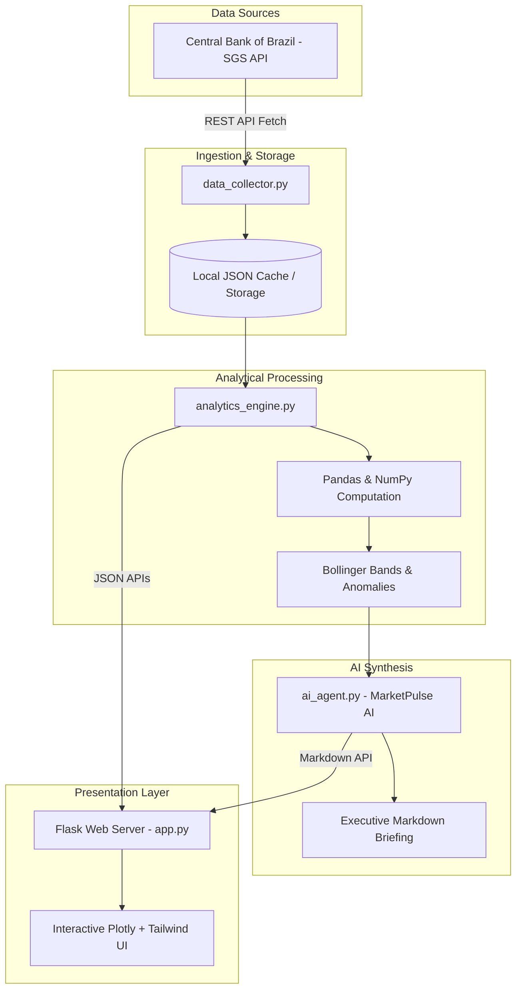

# 📊 MarketPulse AI — Predictive Economic Intelligence & Real-Time Analytics

[](https://python.org)
[](https://pandas.pydata.org)
[](https://plotly.com)
[](https://flask.palletsprojects.com)
[](LICENSE)

**MarketPulse AI** is a production-grade full-stack data science and AI platform that ingests real-time macroeconomic time-series from the Central Bank of Brazil (BACEN), applies rolling statistical models (Bollinger Bands, Moving Averages, Volatility Indices, and Z-Score Anomaly Detection), and uses an autonomous GenAI synthesis agent to generate strategic executive reports for businesses, investors, and local entrepreneurs.

---

## 🚀 Key Highlights

* 🌐 **Live Data Ingestion Pipeline:** Consumes official daily and monthly time series (USD/BRL exchange rate, IPCA inflation, Selic target rate, and IC-Br Agricultural/General Commodities) directly from the Central Bank of Brazil (SGS API).
* 📐 **Statistical & Quantitative Engine:**
  * Rolling Simple Moving Averages (`SMA-7`, `SMA-30`).
  * 30-day Rolling Volatility and Dispersion.
  * Bollinger Band envelopes ($\mu \pm 2\sigma$) for volatility channel projection.
  * Statistical anomaly detection tagging sharp spikes or market trend reversals.
* 🤖 **Autonomous AI Executive Agent:** Synthesizes macroeconomic metrics into actionable business intelligence:
  * Sector-by-sector impacts (Import/Export, Agribusiness, Retail, Animal Nutrition).
  * Risk Matrix (Interest rate capital costs vs. consumer price pass-through).
  * Tactical recommendations and capital preservation playbook.
* 💻 **Interactive Executive Web UI:**
  * Dark-mode glassmorphic interface inspired by modern fintech platforms.
  * Real-time KPI indicator cards with percentage changes.
  * Hardware-accelerated Plotly interactive charts with zoom/pan and anomaly markers.
  * One-click AI Report Generation with full Markdown preview.

---

## 🏗️ Architecture Overview



---

## 📂 Project Structure

```text
marketpulse-ai/
├── app.py                  # Flask Application & Interactive Web Dashboard
├── analytics_engine.py     # Pandas/NumPy Quantitative & Plotly Engine
├── data_collector.py       # BACEN SGS API Ingestion & Cache Management
├── ai_agent.py             # Generative AI Executive Synthesis Agent
├── requirements.txt        # Production dependencies
├── data/
│   └── market_data.json    # Cached historical time series
├── reports/
│   └── latest_briefing.md  # Auto-generated executive briefing
└── README.md               # Documentation & Portfolio Showcase
```

---

## ⚡ Quickstart

### 1. Clone the repository
```bash
git clone https://github.com/TassioSales/marketpulse-ai.git
cd marketpulse-ai
```

### 2. Install dependencies
```bash
pip install -r requirements.txt
```

### 3. Run the application
```bash
python app.py
```
Open your browser and navigate to **`http://localhost:8080`**.

---

## 🔌 API Endpoints

| Endpoint | Method | Description |
| :--- | :--- | :--- |
| `/` | `GET` | Interactive Web Dashboard (Plotly + Tailwind) |
| `/api/metrics` | `GET` | Returns consolidated KPI metrics and 30-day changes |
| `/api/chart/<key>` | `GET` | Returns complete Plotly chart JSON for a specific series (`dolar`, `selic`, `ipca`, `ic_br_agro`) |
| `/api/generate-report` | `GET` | Triggers the AI agent to generate a fresh executive briefing |
| `/api/refresh` | `POST` | Forces cache invalidation and pulls live data from BACEN |

---

## 👨‍💻 Author

Developed with ❤️ by **Tássio Sales**  
* GitHub: [@TassioSales](https://github.com/TassioSales)  
* Passionate about Agentic AI, Full-Stack Architecture, and Quantitative Data Engineering.
